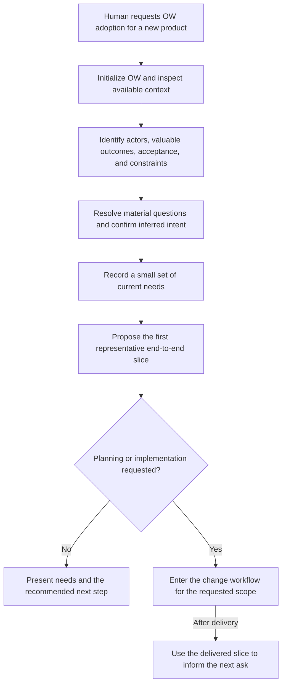
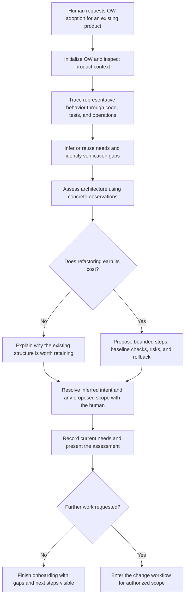
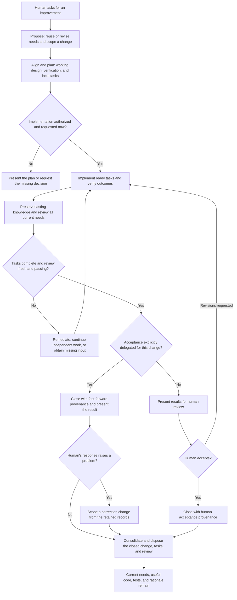

# OpenWish workflows

Humans ask. AI identifies needs, aligns design and engineering, implements, and
reviews. Humans review the results.

OpenWish (OW) uses **Needs → Changes → Tasks**. Needs preserve durable intent;
changes hold a bounded improvement's working design and verification plan; tasks
organize its execution. Code and tests carry the implemented solution after the
accepted change is disposed.

This guide covers:

- [Greenfield onboarding](#greenfield-onboarding): establish intent and choose a
  first useful slice for a new product.
- [Brownfield onboarding](#brownfield-onboarding): recover intent and assess the
  architecture of an existing product.
- [Planning large work](#planning-large-work): turn broad asks into reviewable increments.
- [The change workflow](#the-change-workflow): take an ask through proportionate
  planning, implementation, verification, review, and disposal.

The diagrams show activities and decisions, not mandatory approval gates between
skills. A clear instruction to implement authorizes that scope. Plan-only requests
stop before implementation; material intent or scope decisions need human input.

## Starting onboarding

Adoption is explicit. Ask the agent to adopt OW for the product, or initialize it
in the product repository and invoke onboarding. The default is one product/domain
per repository, including a monorepo.

```sh
ow init
# Or select the harness explicitly:
ow init --harness opencode
```

`ow init` installs project support files and harness integrations. The `ow-onboard`
skill performs the assessment and proposes needs. OpenCode and Claude Code expose
it as `/onboard`; Codex uses `$ow-onboard`. See the
[harness table](../README.md#get-started) for other invocation details.

Onboarding establishes a useful starting point. Product implementation or
refactoring proceeds when that work is also requested. Create changes/tasks only
when planning, substantive implementation, or verification is requested.

## Greenfield onboarding

Use this path when the product has little or no implementation. Start with the
human's desired outcomes and constraints, then learn about architecture by
delivering a small representative end-to-end slice.



### Establish intent

1. **Understand the product.** Identify who needs it, what outcome matters, how
   that outcome can be observed, and which constraints genuinely limit solutions.
   Use any existing sketches, prototypes, interfaces, or repository conventions.
2. **Right-size needs.** Record independently valuable outcomes. A command, screen,
   export format, or module usually implements an outcome rather than warranting
   its own need. Separate outcomes that can be accepted or retired independently.
3. **Resolve meaningful uncertainty.** In default onboarding, confirm inferred
   intent in one useful batch. Preserve actual human decisions in the needs;
   leave inferred intent's `confirmed_at` empty until the human confirms it.

### Choose the first slice

Pick a narrow path that reaches an observable user outcome through real product
boundaries. Establish a conventional, minimal layout with clear responsibility and
data ownership. Keep decisions and transformations pure where practical and put
file, network, database, and other effects at identifiable boundaries.

For example, “finance staff reconcile monthly category totals without copying
rows” can begin with a local CSV input and a usable monthly report. That first
slice exercises input handling, aggregation, and presentation. A later request for
another output format can reuse the same need and aggregation rules.

If implementation is requested, use the [change workflow](#the-change-workflow)
to align the design, implement, verify, and review that slice. On each later ask,
reassess affected boundaries for duplicated rules, scattered responsibilities, or
effects leaking into decisions. Evolve the structure when those observations
justify it. Current needs continue to constrain every subsequent increment.

**Onboarding result:** a small set of current needs, explicit uncertainties, and a
recommended first slice. Once that slice is implemented and accepted, its useful
behavior, checks, and rationale remain in the repository.

## Brownfield onboarding

Use this path for an existing product. The goal is to establish useful durable
intent, understand the actual architecture, and identify whether targeted
improvements would earn their cost.



### Recover intent from evidence

Inspect product descriptions, public interfaces, representative user paths,
source, tests, deployment configuration, and operational constraints. Follow a
behavior through its dependencies rather than assessing architecture from the
file tree alone.

Existing code demonstrates behavior; it does not establish confirmed intent or
prove that the desired outcome works. Distinguish inspected behavior, checks
actually run, assumptions, and unverified observations. Reuse meaningful existing
outcome checks and identify consequential gaps without enshrining known bugs as
requirements.

Propose a small set of needs and label inference. On repeated onboarding, compare
actor, outcome, acceptance, and constraints with existing needs and reuse their
IDs. Consolidate duplicates or split independent outcomes while preserving intent
and reconciling references. Store useful, reasoned `requires` or `constrains`
relationships on needs; all current needs remain relevant even without links.

### Assess architecture and propose useful work

Apply the [shared architecture rubric](../src/openwish/assets/skills/ow-align/SKILL.md#architecture-rubric):
can behavior be found, do rules have clear owners, are dependencies and data
ownership explicit, can decisions run independently of effects, do tests check
outcomes, and does complexity serve a demonstrated need?

Report each consequential finding as **observation → consequence → recommendation**,
with code/test references. Compare retaining the current structure with the
smallest useful improvement. A satisfactory architecture is a valid result.

A useful refactor proposal explains:

- The affected scope and behavior or constraints to preserve.
- Existing baseline checks and small additions needed for meaningful gaps.
- Incremental steps and the responsibility, dependency, or effect boundaries they improve.
- Expected benefit, cost, risk, and how each step will be verified or rolled back.

Obtain human approval for additional refactoring scope before product edits.
Combine this decision with inferred-intent confirmation when useful. Onboarding
or delegated intent inference alone does not authorize a rewrite. If the human
defers the proposal, retain the existing structure and make the decision visible.

**Onboarding result:** current needs, a code-grounded assessment, useful operational
knowledge, and visible gaps or proposals. Keep the assessment in conversation or
an appropriate disposable change. Preserve selected operational facts and
otherwise unrecoverable rationale in ordinary repository docs or nearby comments.
A requested verification-only change may have no implementation tasks, but still
needs actual checks and review.

## Planning large work

A need describes durable value; a change describes an independently reviewable
improvement. A modernization may justify dozens of needs and many changes. Calling
the whole first release a "pilot" does not make it one manageable change.

Use [Right-size delivery](../src/openwish/assets/skills/ow-propose/SKILL.md#right-size-delivery)
before making tasks. Ask what concrete result can be accepted and retained if later
work is postponed. Split separately acceptable improvements; combine work that needs
joint acceptance. A shared database or sequential dependency does not imply a single
change. Many need references can still be appropriate for one narrow improvement.

For each candidate, identify:

| Boundary | Question |
| --- | --- |
| Delivers now | Which observable results does this increment contribute to its needs? |
| Preserves | Which existing behavior and applicable constraints must hold? |
| Defers | Which remaining outcomes belong to later work, and which change takes each? |
| Prerequisites | Which capabilities must exist before execution, which existing code or predecessor provides each, and how is its presence verified? |
| Exit evidence | What would let someone accept this result independently? |

Write tasks only for ready increments: their prerequisite capabilities exist in the
repository and no material decision is open. For a requested resumable plan, retain
the others as concise open changes with empty task lists and say that their planning
is incomplete, but give their consequential unknowns `investigate` tasks now: an
investigation ignores its change's `after` gate, so a decision the fifth change
depends on can be settled while the first is built. Name each change's predecessors
in `after`. Once they pass review (or
acceptance, if configured), `ow ready` shows the change as `PLAN`; apply
[Plan a candidate](../src/openwish/assets/skills/ow-plan/SKILL.md#plan-a-candidate):
verify prerequisites in the code, refresh the approach against delivered interfaces,
then write tasks. Acceptance follows the sequence, and a predecessor's review usually
needs refreshing before it closes because successors have since edited files.
Assessment-only sequences can stay in conversation. Before presenting a sequence,
[check it](../src/openwish/assets/skills/ow-propose/SKILL.md#right-size-delivery):
every prerequisite has a provider among existing code or predecessors, every
deferral has a destination, and every covered acceptance criterion has an owner.
For a long sequence, [assess its readiness](../src/openwish/assets/skills/ow-assess/SKILL.md)
against a declared horizon first: rate the evidence, run a pre-mortem, rank the
unknowns by the cost of learning them late, and state a confidence.
Foundational changes come first and carry every later need, so
[test them against future constraints](../src/openwish/assets/skills/ow-align/SKILL.md#future-constraints):
preserve a later need's constraint now when cheap, resolve it before the commitment
when it changes the shape, or record an affordable evolution path.

**Progressive commitment.** Uncertainty is settled before the commitment it could
disrupt, not before all work. Persisted data shapes, money and permission rules,
public interfaces and deploys wait for the decisions their result depends on;
reversible choices proceed on a recommended, labeled assumption that stays in the
need's `open` list until a human decides. Questions go to the human in batches,
through concrete cases, hardest-to-reverse first; see
[Commit progressively](../src/openwish/assets/skills/ow-plan/SKILL.md#commit-progressively).

For example, a clinic scheduling product could progress through one clinician's
bookable calendar that a patient books end to end, then reminders, then multi-site
staffing. Each increment includes the interface, persistence and checks needed to
demonstrate it. A task called "implement scheduling, notifications and staffing"
would conceal most of that delivery plan.

Use enough tasks to expose meaningful completion and blocking boundaries. Keep
coherent implementation and focused checks together; do not optimize for a short
list or create a task per file. Map every promised result to work or existing evidence.
Integrate representative behavior early instead of postponing all integration.

When requirements grow or work resumes, apply
[Reconcile the plan](../src/openwish/assets/skills/ow-plan/SKILL.md#reconcile-the-plan)
before trusting `ow ready`. Moved work is not done work, and successors should describe
prerequisites in terms of delivered code and checks before an earlier change is
disposed. An empty future task list is not completion.

## The change workflow

This workflow applies to the first greenfield slice, approved brownfield
improvements, and later product asks. Start by reading current intent and the
affected code/tests. Reuse an existing need when the ask introduces another
mechanism for the same outcome; revise or add needs when intent genuinely changes.

### Choose direct or managed delivery

Every product change recovers current intent, reconciles the ask, clarifies only
consequential uncertainty, designs with the architecture rubric, verifies and
reviews, in proportion to the ask. The delivery choice changes only what is recorded.

**Direct delivery** fits one coherent result that can be finished and verified in the
session, with no material open decision, nothing deferred, and no active change
covering it. It needs no change file, tasks or final acceptance ceremony, but still
revises needs when intent changes. Honor plan-only requests here too. Work already
tracked in an active change continues there, including unresolved manual checks.
Promote direct work to a change when coordination needs appear: one change for the
whole result, completed work as done tasks with direct evidence, and the remainder
as open, blocked or manual tasks. A skill entered before this intake reconciles
needs and chooses delivery first.

**Managed delivery** serves work needing several increments, resumption, deferred
obligations, sequencing, manual blockers or delayed acceptance. Scope one or more
reviewable changes referencing motivating needs, then follow this flow for each
selected increment:



While awaiting a human decision or manual observation, retain the work and report
the blocker. The loop represents progress when work or input is available. If a
revision materially changes intent or scope, return to alignment and the relevant
human decision before implementing it.

### 1. Propose, align, and plan

Use `ow-propose`, `ow-align`, and `ow-plan` to prepare needs, design, and tasks
together. A change holds its purpose, delivery scope, approach, and exit evidence.
Tasks have concrete acceptance; optional prerequisites form an acyclic graph within
that change. A small change may have one task. Verification-only work or future candidates
awaiting detailed planning may have none; actual completion still needs direct evidence.

Load all current needs with `ow context`; inspect affected interfaces, consumers
and tests. `ow graph` and `ow trace` focus investigation on related intent and the
checks protecting it, but unlinked current needs still constrain the result.
A task is executable when it no longer requires inventing consequential product
policy. Verification follows
[Strategic verification](../src/openwish/assets/skills/ow-plan/SKILL.md#strategic-verification);
need-level tests mention the need ID they protect so `ow trace` can find them.

A clear implementation request supplies authority for its scope. Technical plan
repairs within that scope need no repeated permission. If only planning was
requested, present the prepared change and stop.

### 2. Implement and verify

Use `ow-implement` and `ow ready C-001` to select work subject to local
prerequisites; readiness is scheduling, not permission. Implement the smallest
coherent solution, then verify and record evidence with
`ow task C-001/T-001 done --evidence "..."`. Continue independent tasks around
blocked or manual work, and update the working approach as you learn.

### 3. Review and accept

Use `ow-review` to assess actual outcomes and the diff against **all current
needs**, including delivered outcomes. Check affected behavior and explain
unaffected constraints briefly. Before final review, put lasting behavior in code,
regression checks in tests, updated intent in needs, and useful rationale nearby.

Run the relevant checks and `ow check`, then record the result with
`ow record-review C-001 ... [--affected N-003] --handoff FILE`. Linked needs are
always recorded as affected; every other current need is recorded as assessed and
unaffected, so the reviewer must actually judge it. The handoff maps each material
requirement to retained files and evidence
([format](../src/openwish/assets/skills/ow-core/artifacts.md#review-closure-and-disposal)) and lives
only in the disposable review. Unresolved findings use `--verdict blocked`.

Present **need → outcome → evidence**, with remaining limitations. In default
mode, keep the change until the human actually accepts the results. If anything the
review depended on changes meanwhile, `ow summary C-001` names what changed; refresh
the affected verification and record the review again before closing.

**Explicit fast-forward** delegates acceptance for the selected change. It retains
the same implementation, verification, and AI review obligations, and closes with
delegation provenance. Its records stay until the human has responded to the
presented result, so a problem found at that first look is scoped as a correction
from them. It does not fabricate observations or human confirmation,
override plan-only scope, or apply to unrelated future changes. When onboarding
under explicit fast-forward, inferred intent remains unconfirmed; proposed
additional refactoring still needs scope authorization.

### 4. Close and dispose

After acceptance, close with the correct provenance and use `ow-consolidate` to
preserve useful knowledge and clean the closed change:

| Command | When to use it |
| --- | --- |
| `ow summary C-001` | Inspect the outcome, evidence, and review freshness |
| `ow close C-001 --by human` | After actual human acceptance and a fresh passing review |
| `ow close C-001 --by fast-forward` | After a fresh passing review under explicit change-scoped delegation |
| `ow clean C-001` | Dispose the closed change after useful knowledge is preserved |
| `ow clean C-001 --dry-run --json` | Preview removals, retained handoff destinations and reference warnings |

`ow clean` removes the known change, task, and review files together after
preflight. Unknown files cause refusal and remain available for deliberate
handling. Report any reason for deferring disposal. Use `ow status` to find
cleanup candidates, results awaiting acceptance, blocked/manual work, and retired
needs.

Preflight also rejects missing or ignored handoff destinations, destinations within the
deletion batch and incoming handoff dependencies, and warns about retained files that
still mention the change ID.

## What survives each completed change

| Knowledge | Durable home |
| --- | --- |
| Actors, outcomes, acceptance, and constraints | Current needs |
| Implemented behavior and interfaces | Source, types, and schemas |
| Repeatable outcome and regression checks | Tests and useful manual procedures |
| Module and boundary responsibilities | A short header per module; a README at major boundaries |
| Essential rationale and operational facts | Nearby comments or ordinary repository docs |
| Approved unfinished detail | Another active change or appropriate retained domain data |

Needs remain current after delivery and can serve later changes. Retirement,
merging, splitting, or removal is an intent/retention decision that preserves
meaning and reconciles references. New changes default to human review unless
explicitly delegated again.

Retained tests enable fresh verification; temporary probes and run results can
disappear once their findings are preserved. Git holds history. Keep historical proof
as product data only when a need requires it.

For details, see the [product requirements](product.md),
[framework design](design.md), [OW policy](../src/openwish/assets/skills/ow-core/SKILL.md),
and [artifact reference](../src/openwish/assets/skills/ow-core/artifacts.md).
